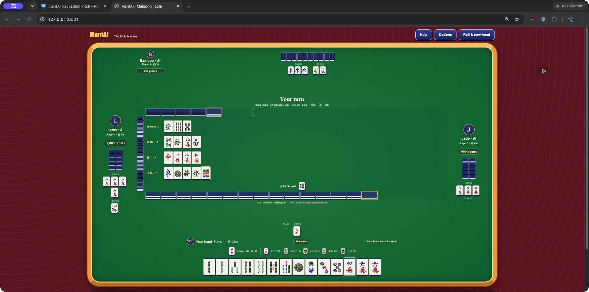
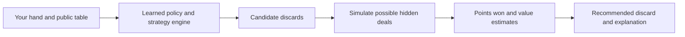

# mantAI

**An AlphaGo-inspired AI for Singapore Mahjong, aiming to beat three human
players through machine learning and reinforcement learning.** The browser game
lets you play Player 1 against three computer opponents and follow the AI's
discard and claim recommendations. A learned policy, statistical hand analysis,
decision engines, and search over possible hidden deals support its decisions.
Performance against real humans has not yet been measured.

Singapore Mahjong requires balancing hand improvement, scoring potential, and
the risk of giving an opponent a winning tile. mantAI turns those tradeoffs into
an actionable recommendation, using only your concealed hand and public table
information. The browser is a playable demonstration and a way to review the
AI's decisions.

The included default now uses the improved learned discard policy with
strategy-engine calls and its matching value model. It was trained with
engine examples and reinforcement learning against varied opponents.



## Quick start

Python 3.9 or newer.

```bash
git clone https://github.com/dy1anwkj/mantAI.git
cd mantAI
python3 -m venv .venv
source .venv/bin/activate          # Windows: .venv\Scripts\activate
pip install -r requirements.txt
python web_game.py
```

Open **http://127.0.0.1:8002** and select **Play**. The trained models are
included in `models/`, so there is nothing to train first. Without PyTorch the
game still runs, with the strategy engine making the recommendations.

## Try the demo

1. Select **Play** and watch the three-dice wall break and dealing sequence.
2. Read the recommended discard, estimated win chance, and candidate search
   scores. Click a tile to play; opponents respond automatically.
3. When a claim is offered, follow the highlighted Chi, Pong, Kong, Hu, or Pass
   recommendation. Finish a hand to see tai, payments, and updated balances.

Recommendations can take several seconds to calculate. **Options** controls
action pacing and whether recommendations are displayed. No API key or external
AI service is required; the models run locally.

## What you see

- **Three-dice opening:** dice select the wall break, followed by animated
  dealing. The backend uses that break to deal the actual hands.
- **Physical walls:** 74 two-tile stacks surround the discard field. Wall
  occupancy follows actual draws, with gold marking the live draw end and
  pink marking the flower/Kong replacement end.
- **Point balances:** each player starts with 1,000 points. Kong, bonus, and
  winning-hand payments update balances, which carry across hands until the
  server restarts. One scoring unit equals one point.
- **The recommendation box**, above your hand: the tile to discard, your
  estimated chance of winning the hand after it, and every tile the search
  compared as `score (playouts)`, the pick highlighted.
- **Claims:** when you can Chi, Pong, Kong or Hu, the box recommends an action
  and outlines its button, including the exact tiles for Chi. It can also
  recommend Pass. A legal Hu is always recommended; claim hints do not show
  a simulated win percentage.
- **Human-style opponents:** each opponent plays its own style, aggressive,
  balanced or cautious, as stand-ins for the human players mantAI is meant to beat.
- **Optional hand review:** start with `--save-hands` to save hands to
  `data/web_hands/`, including moves, recommendations, and your choices.
- **Options:** adjust action pacing and enable or disable recommendations.

Table rows expand to fit exposed tiles, recommendations and result badges.
Short windows scroll vertically; narrow screens can also scroll horizontally.

This is a local single-player table; there is no online multiplayer. Browser
tabs share the same game. Refreshing preserves the hand and point balances while
the Python server stays running.

More detail on the web game: [docs/WEB_GAME.md](docs/WEB_GAME.md).

## How it decides

mantAI combines policy and value networks with search, inspired by AlphaGo and
adapted to a game with hidden tiles
([mantai_ml/search.py](mantai_ml/search.py)):



1. **Policy network.** Starts with hand analysis and strategy features encoded
   from the study library ([mantai_ml/knowledge.py](mantai_ml/knowledge.py)),
   then improves through reinforcement learning, rewarded by points won. It
   proposes the most promising discards. The hand-tuned strategy engine's pick
   is always tested too.
2. **Guessed deals.** Opponents' hands are hidden, so each playout deals out a
   possible version of them, weighted by what each opponent has thrown and
   claimed.
3. **Search.** Every candidate tile is played out to the end of the hand on the
   *same* guessed deals, so the differences come from the discard, not from luck.
   Each playout is scored half by the points actually won and half by a value
   network's estimate of the position. Playouts are allocated with PUCT,
   AlphaGo's rule.
4. **Decision.** The network's first choice is kept unless another tile scored
   clearly better on the same deals, by a margin of 1.5 standard errors.

The strategy engine measures distance from ready, unseen improving tiles,
scoring potential, and defensive risk. A learned opponent model estimates
readiness and deal-in risk from public information. The displayed win chance
is a noisy estimate from simulations; the search compares expected points.

## Results

The corrected decision code was tested on **10,000 identical starting deals per
policy**, in two batches of 5,000 against human-style engine opponents. Rule checks
found no errors. These are policy results **without search**; one unit equals one point.

| Player 1 plays as | Win rate | Points per hand | Deal-in rate |
|---|---:|---:|---:|
| **Default policy: learned discards, engine calls** | **28.84%** | **+0.5943** | **15.06%** |
| Experimental learner-visited-state candidate | 29.18% | +0.6770 | 14.54% |

- The candidate's gain was **+0.0827 points per hand**, with an approximate paired
  95% interval of **[-0.1101, +0.2755]**. This does not establish superiority, so
  the default policy is retained. Its value model has been recalibrated separately.
- Additional fine-tuning, reinforcement learning, and a larger network did not
  establish stronger play. Candidate selection is gated by game outcomes, not
  teacher agreement alone.
- On the first 5,000 deals, the strategy engine scored +0.8830 points per hand
  versus the default's +0.4378. Engine strength, full search performance, and
  evaluation against real humans remain the next priorities.

Details and limitations: [training improvements](docs/TRAINING_IMPROVEMENTS.md).
The [latest retraining evaluation](docs/retraining_evaluation.json) records the
seeds, candidate comparisons, and uncertainty. [Earlier metrics](docs/evaluation_summary.json)
precede the accounting fixes and are retained as historical results.

The experimental policy and a compatible calibrated critic are included for
review; using them is optional:

```bash
python web_game.py --model models/visited_candidate.pt
```

## Rules

Singapore Mahjong with the 148-tile set (flowers, seasons and animals included),
1 tai minimum, 5 tai maximum and a 15-tile dead wall. Where sources disagree,
SPGG Mahjong Rules 2024 decides. Rules and scoring:
[singapore_rules.py](singapore_rules.py) and [mahjong_simulator.py](mahjong_simulator.py).

The [winning-hand reference review](docs/WINNING_HAND_REFERENCES.md) compares
the supplied online guides with current scoring and records gaps in special-hand
planning. These study notes do not imply that the deployed model was retrained.

## Project layout

| Path | What it is |
|---|---|
| [web_game.py](web_game.py), [web/](web) | The browser game: a local server plus HTML, CSS and JavaScript |
| [mahjong_simulator.py](mahjong_simulator.py) | The game: deal, turns, claims, scoring and the playout simulator |
| [wall_setup.py](wall_setup.py), [web/table_scene.js](web/table_scene.js) | Three-dice wall break, physical dealing, and table animations |
| [singapore_rules.py](singapore_rules.py) | Tai scoring and payments |
| [Decision_Strategy_engine.py](Decision_Strategy_engine.py) | The hand-tuned strategy engine (also the opponents) |
| [D_hand_eval.py](D_hand_eval.py) | Hand evaluation: winning shapes, waits, tile efficiency |
| [R_opponent_analysis.py](R_opponent_analysis.py) | Learned danger model: how likely a tile is to let an opponent win |
| [mantai_ml/](mantai_ml) | Policy and value networks, self-play training and the search |
| [models/](models) | Default policy `alpha_best.pt`, matching `alpha_best_critic.pt`, legacy critic, and `danger.npz` |
| [tests/](tests) | Tests (`python -m pytest`) |
| [tools/](tools) | Engine tuning and `evaluate_models.py` for identical-deal policy comparisons |
| [docs/](docs) | The web game guide and the rule and strategy books the network started from |

## Training

By default the command trains the learned player against three strategy-engine
opponents. `--opponent-models` mixes frozen learned policies and the current
policy with engine opponents; only Player 1's policy is updated. `--engine-calls`
keeps claims under the strategy engine while learning discards.
Self-play evaluates the starting policy on the checkpoint-selection deals and
keeps it as the best checkpoint if all subsequent updates score worse.
`--games` is the number of games **per iteration**; total training games are
`--iterations × --games`. Evaluation games are additional.
Supervised training retains the epoch with the best held-out discard agreement;
candidate policies still need separate playing-strength evaluation.

The value model can also be calibrated on separate engine-played games, matching
search's continuation policy. Training retains the best held-out critic and keeps
the previous critic if it performs better:

```bash
python -m mantai_ml train-value --model models/alpha_best.pt --games 2000 --val-games 500 --epochs 20
```

The included critic has been recalibrated on 2,000 engine-played training games
and 500 separate validation games. Held-out value prediction RMSE decreased
from **9.168 to 8.456 scoring units** (about 7.8%). This measures prediction error,
not a demonstrated increase in search win rate. See [calibration metrics](docs/value_calibration.json).

To teach the learner on states reached by its own moves, record model-played
games with engine labels, then fine-tune. Records retain both the actual move
and the teacher's recommendation. Use equal game weights because outcomes belong
to the learner's played moves, not the teacher's hypothetical alternatives:

```bash
python -m mantai_ml record --player1 ml --model models/alpha_best.pt --teacher --games 2000 --out data/visited.jsonl
python -m mantai_ml train --init models/alpha_best.pt --data data/visited.jsonl --win-weight 1 --out models/visited.pt
```

```bash
# Self-play from the book-based starting point
python -m mantai_ml selfplay --iterations 1200 --games 400 --shaping 0 --out models/alpha.pt

# Measure a model against the strategy engine, with and without search
python -m mantai_ml evaluate --model models/alpha_best.pt --games 1000 --compare
python -m mantai_ml evaluate --model models/alpha_best.pt --games 200 --search 64 --compare
```

To continue the included policy for 1,000 training games and save separate
checkpoints:

```bash
python -m mantai_ml selfplay --init models/alpha_best.pt --iterations 10 --games 100 --shaping 0 --eval-games 100 --out models/continued.pt
python web_game.py --model models/continued.pt
```

`python -m mantai_ml --help` lists every command.

For identical-deal comparisons with rule checks and approximate confidence
intervals:

```bash
python tools/evaluate_models.py --models models/alpha_best.pt --games 5000 --seed 20261014000 --out data/model_comparison.json
```

The included checkpoint is compared with the strategy engine. Add another model
path to compare policies; the first model is the baseline. Raw training data and
other experiment checkpoints are gitignored and are not required to play.

`--search-reference engine` lets the browser's search keep the strategy engine's
discard unless a challenger scores clearly better on paired simulations. The
default reference remains the network. See [training improvements](docs/TRAINING_IMPROVEMENTS.md)
for the new training workflow and evaluation details.

## Tests

```bash
python -m pytest
```

The video tests additionally need `opencv-python` and `pillow`. Without PyTorch,
the ML tests are skipped. Wall setup and browser integration checks are in
`tests/test_wall_setup.py` and `tests/test_web_game.py`.

The October 10 project audit passed all 262 tests, including the optional video
pipeline and HTTP integration. Coverage includes winning shapes, scoring, tile conservation,
legal actions, model training, physical dealing, and HTTP integration.

The audit fixed unseen-tile counts after discards and claims, two-step lookahead
accounting, Chi option selection at equal shanten, and invalid training settings.
Details are in [the correctness audit](docs/TRAINING_IMPROVEMENTS.md#subsequent-correctness-audit).

Hand and suit evaluation caches have fixed size limits so long search and
training sessions do not retain every position indefinitely. Replaying 160
seeded games with caches retained versus cleared produced identical outcomes.
See [the project audit](docs/PROJECT_AUDIT.md) for validation scope and limits.
