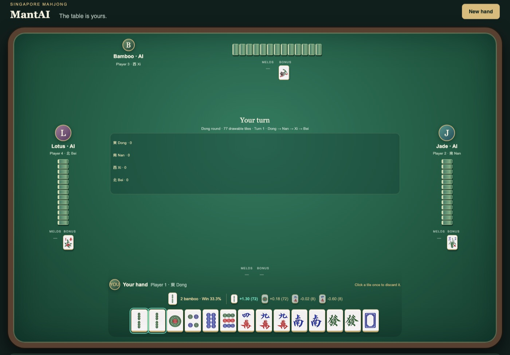

# mantAI

**An AlphaGo-style coach for Singapore Mahjong.** You play Player 1 in the browser
against three computer opponents. On every move, mantAI tells you what to do and
shows the numbers behind it: a self-play network proposes discards, and a search
plays each one out on guessed versions of the hidden tiles before recommending it.



## Quick start

Python 3.9 or newer.

```bash
git clone https://github.com/dy1anwkj/mantAI.git
cd mantAI
python3 -m venv .venv
source .venv/bin/activate          # Windows: .venv\Scripts\activate
pip install -r requirements.txt
python web_game.py
```

Open **http://127.0.0.1:8000** and click **New hand**. The trained models are
included in `models/`, so there is nothing to train first. Without PyTorch the
game still runs, with the strategy engine making the recommendations.

## What you see

- **The recommendation box**, above your hand: the tile to discard, your
  estimated chance of winning the hand after it, and every tile the search
  compared as `score (playouts)`, the pick highlighted.
- **Claims:** when you can Chi, Pong, Kong or Hu, the box recommends an action
  and outlines its button. A legal Hu is always recommended.
- **Human-style opponents:** each opponent plays its own style, aggressive,
  balanced or cautious, as stand-ins for the human players mantAI is meant to beat.
- **Saved hands for review:** each hand is saved to `data/web_hands/` with every
  move, what was recommended and what you chose. `--no-save` turns this off.

More detail on the web game: [WEB_GAME.md](WEB_GAME.md).

## How it decides

mantAI follows the recipe AlphaGo used, adapted to a game with hidden tiles
([mantai_ml/search.py](mantai_ml/search.py)):

1. **Policy network.** Trained from a library of Mahjong rule and strategy
   books ([mantai_ml/knowledge.py](mantai_ml/knowledge.py)), then improved by
   self-play reinforcement learning under the rules, rewarded by points won. It
   proposes the most promising discards. The hand-tuned strategy engine's pick
   is always tested too.
2. **Guessed deals.** Opponents' hands are hidden, so each playout deals out a
   possible version of them, weighted by what each opponent has thrown and
   claimed.
3. **Search.** Every candidate tile is played out to the end of the hand on the
   *same* guessed deals, so the differences come from the discard, not from luck.
   Each playout is scored half by the points actually won and half by a value
   network's estimate of the position. Playouts are allocated with PUCT,
   AlphaGo's rule.
4. **Decision.** The network's first choice is kept unless another tile scored
   clearly better on the same deals, by a margin of 1.5 standard errors.

## Results

Against the human-style opponents, playing every move by the recommendation
(Player 1's points per hand; 0 is break-even and a fair share of wins is 25%):

| Player 1 plays as | Hands | Win rate | Points per hand |
|---|---|---|---|
| Network + search (the recommendation) | 200 | 26% | **+1.30** |
| Trained network alone | 2,000 | 26% | +0.27 |
| Hand-tuned strategy engine | 2,000 | 33% | +0.99 |
| Engine, on the same 200 deals as the search | 200 | 35% | +1.47 |

- The search turns a weak network (+0.27) into a winning player (+1.30). It wins
  less often than the engine but scores bigger hands.
- The hand-tuned engine is still slightly ahead. Closing that gap through more
  self-play is the next step.
- Chi, Pong and Kong recommendations come from the engine: with the engine
  discarding, engine calls scored +1.40 a hand against +0.79 for the network's
  calls over 4,000 deals.
- These results are against simulated opponents. mantAI has not yet been
  measured against human players.

## Rules

Singapore Mahjong with the 148-tile set (flowers, seasons and animals included),
1 tai minimum, 5 tai maximum and a 15-tile dead wall. Where sources disagree,
SPGG Mahjong Rules 2024 decides. Rules and scoring:
[singapore_rules.py](singapore_rules.py) and [mahjong_simulator.py](mahjong_simulator.py).

## Project layout

| Path | What it is |
|---|---|
| [web_game.py](web_game.py), [web/](web) | The browser game: a local server plus HTML, CSS and JavaScript |
| [mahjong_simulator.py](mahjong_simulator.py) | The game: deal, turns, claims, scoring and the playout simulator |
| [singapore_rules.py](singapore_rules.py) | Tai scoring and payments |
| [Decision_Strategy_engine.py](Decision_Strategy_engine.py) | The hand-tuned strategy engine (also the opponents) |
| [D_hand_eval.py](D_hand_eval.py) | Hand evaluation: winning shapes, waits, tile efficiency |
| [R_opponent_analysis.py](R_opponent_analysis.py) | Learned danger model: how likely a tile is to let an opponent win |
| [mantai_ml/](mantai_ml) | Policy and value networks, self-play training and the search |
| [models/](models) | Trained models: `alpha_best.pt`, `alpha_critic.pt`, `danger.npz` |
| `test_*.py` | Tests |

## Training

```bash
# Self-play from the book-based starting point
python -m mantai_ml selfplay --iterations 1200 --games 400 --shaping 0 --out models/alpha.pt

# Measure a model against the strategy engine, with and without search
python -m mantai_ml evaluate --model models/alpha_best.pt --games 1000 --compare
python -m mantai_ml evaluate --model models/alpha_best.pt --games 200 --search 64 --compare
```

`python -m mantai_ml --help` lists every command.

## Tests

```bash
python -m pytest
```
